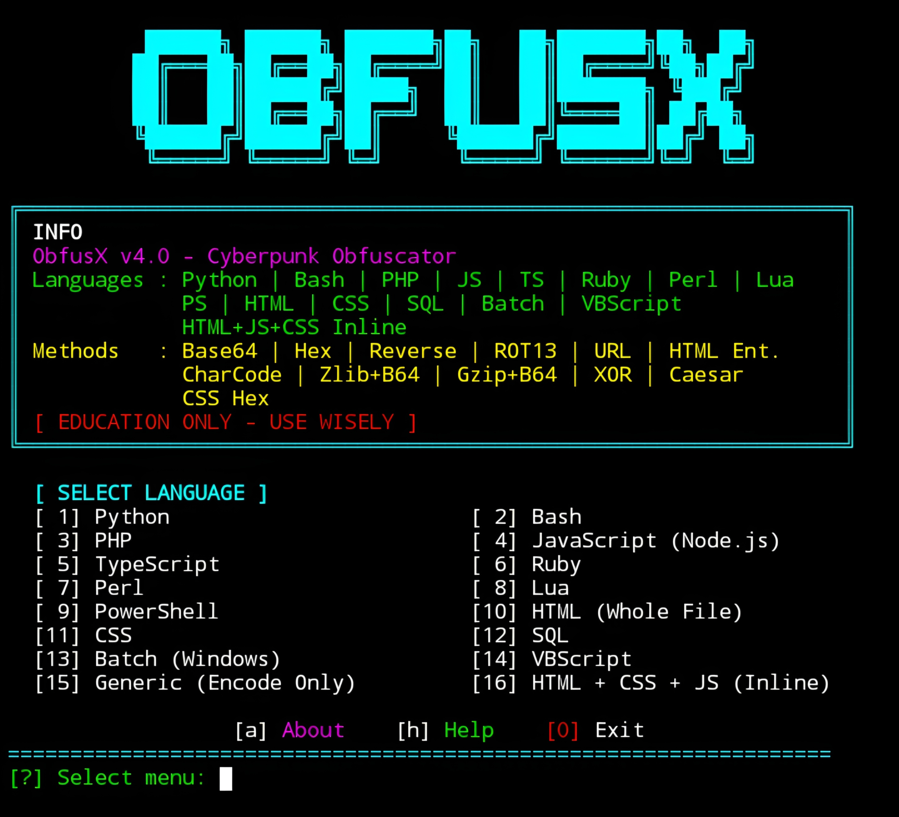

# ObfusX v4.0


<p align="center">
  <strong>Cyberpunk Obfuscator – Overpower Edition</strong><br>
  <em>"Make your code unreadable. Stay invisible." – Mr.X</em>
</p>

## Introduction
ObfusX v4.0 is a powerful cyberpunk-themed code obfuscator built for **Termux (Android)**, Linux, and any Unix-like environment—**no root required**. It transforms your source code into a heavily obfuscated form using a wide range of encoding techniques, making it extremely difficult for humans to read or understand. Supporting **14 programming and markup languages** and **17+ obfuscation methods**, ObfusX is an essential tool for developers who want to protect their intellectual property or add an extra layer of security to their scripts.

## Installation
```bash
$ pkg update -y && pkg upgrade -y
$ pkg install git python -y
$ git clone https://github.com/Whomrx666/Obfusx.git
$ cd Obfusx
$ python3 install.py
```

## Run manually
```bash
$ python3 obfusx.py
```

## Features
- **14 Supported Languages** – Python, Bash, PHP, JavaScript, TypeScript, Ruby, Perl, Lua, PowerShell, HTML, CSS, SQL, Batch, VBScript, plus HTML+CSS+JS Inline.
- **17+ Obfuscation Methods** – Base64, Hex, Reverse, ROT13, URL Encode, HTML Entities, CharCode, Zlib+Base64, Gzip+Base64, XOR+Base64, Caesar, CSS Hex Escape, and combinations like Base64+Reverse, Double Base64, Hex+Reverse.
- **Inline HTML Obfuscation** – Special mode to obfuscate `<script>` and `<style>` blocks inside HTML files using CharCode or Base64+atob.
- **Cyberpunk UI** – Neon colors, dynamic borders, centered menus, loading screen, and exit messages.
- **Termux Optimized** – Works flawlessly on Android without root.
- **No Dependencies** – Pure Python, uses only built-in modules.
- **Education Only** – Intended for learning and authorized use.

## Supported Languages & Methods
| Language | Methods |
|----------|---------|
| Python | base64, zlib_b64, gzip_b64, hex, reverse, rot13, charcode, xor_b64, caesar, url, base64_reverse, zlib_hex, double_base64 |
| Bash | base64, hex, reverse, rot13, url, caesar, base64_reverse, hex_reverse, double_base64 |
| PHP | base64, zlib_b64, gzip_b64, hex, reverse, rot13, charcode, url, base64_reverse, double_base64 |
| JavaScript | base64, hex, reverse, rot13, charcode, url, gzip_b64, base64_reverse, double_base64 |
| TypeScript | base64, hex, reverse, rot13, charcode, url, base64_reverse, double_base64 |
| Ruby | base64, hex, reverse, rot13, charcode, url, base64_reverse, double_base64 |
| Perl | base64, hex, reverse, rot13, charcode, url |
| Lua | hex, reverse, charcode, base64 |
| PowerShell | base64, hex, reverse, rot13, charcode |
| HTML | html_entities, url, base64, hex |
| CSS | hex, url, base64, css_hex_escape |
| SQL | generic methods (base64, hex, reverse, rot13, url, etc.) |
| Batch | generic methods |
| VBScript | generic methods |
| HTML + CSS + JS Inline | charcode, base64_browser |

## Menu Options
After running the tool, you will see a list of languages. Select a language number to proceed. Additional menu options:
- `[a]` About – View information about the tool
- `[h]` Help – Display usage instructions
- `[0]` Exit – Quit the program

When you select a language, you will be presented with all available obfuscation methods for that language. Choose a method, then enter the input and output file paths.

## Instructions
1. **Install** the tool using the commands above.
2. **Run** `python3 obfusx.py` to start.
3. **Select a language** – e.g., Python, Bash, PHP, etc.
4. **Choose an obfuscation method** – e.g., base64, hex, reverse, etc.
5. **Enter input file path** – The source code file you want to obfuscate.
6. **Enter output file path** – Where the obfuscated code will be saved (leave empty for automatic naming).
7. **For HTML+CSS+JS Inline** – Select option `14` and choose the JavaScript obfuscation method (CharCode or Base64+atob).
8. **View the result** – The obfuscated code will be written to the output file.

## Observation
This tool is intended for **educational and authorized use only**. Obfuscation does not provide absolute security and can be reversed with enough effort. The author is not responsible for any misuse or damage caused by this tool. Always ensure you have the rights to modify and distribute the code you obfuscate.

### Original Author
<a href="https://github.com/Whomrx666"></a>

### <<< If you copy, then give me the credits >>>

## CONNECT WITH ME :

[](https://whomrx.pages.dev)
[](https://whomrxhackers.blogspot.com)
[](https://twitter.com/whomrx666)
[](https://wa.me/6285926601133?text=Halo%2C%20Mr.X)
[](https://www.facebook.com/whomrx.666)
[](https://t.me/Whomr_X)
[](mailto:whomrx666@gmail.com)
[](https://www.tiktok.com/@whomr.x)

**If you want to donate, click on the button**
<a href="https://saweria.co/whomrx"></a>

---

<p align="left">
  
</p>